# Lab 03: Book Management API

## Live Deployment

Not deployed yet. The project is currently running locally on `localhost:3000`.

## Student Details

| Partuculars | Details | Particulars | Details |
|---|---|---|---|
| **Name** | L. Rizwana | **Term** | 2 |
| **Registration Number** | 252U1R5090 | **Module Number** | 3 |
| **Class & Section** | AI&DE-2B | **Module Title** | RESTful API Development and Validation |
| **Subject** | Backend Development Fundamentals | **Submission Date** | 11-11-2026 |

## Project Description

This project is a Book Management API developed using Node.js, Express.js and SQLite. It allows users to add, view, update and delete book records.

## Technologies Used

- Node.js
- Express.js
- SQLite
- Postman

## How to Run the Project

1. Clone or download this repository.

2. Open the project folder in VS Code.

3. Install the required packages:

   `npm install`

4. Create the database:

   `node initDB.js`

5. Start the server:

   `node app.js`

6. Open `http://localhost:3000/` in your browser.

## API Endpoints

| Method | Endpoint          | Description      |
| ------ | ----------------- | ---------------- |
| GET    | `/books/`         | Get all books    |
| GET    | `/books/:bookId/` | Get a book by ID |
| POST   | `/books/`         | Add a new book   |
| PUT    | `/books/:bookId/` | Update a book    |
| DELETE | `/books/:bookId/` | Delete a book    |

## Screenshots

### 1. GET - All Books
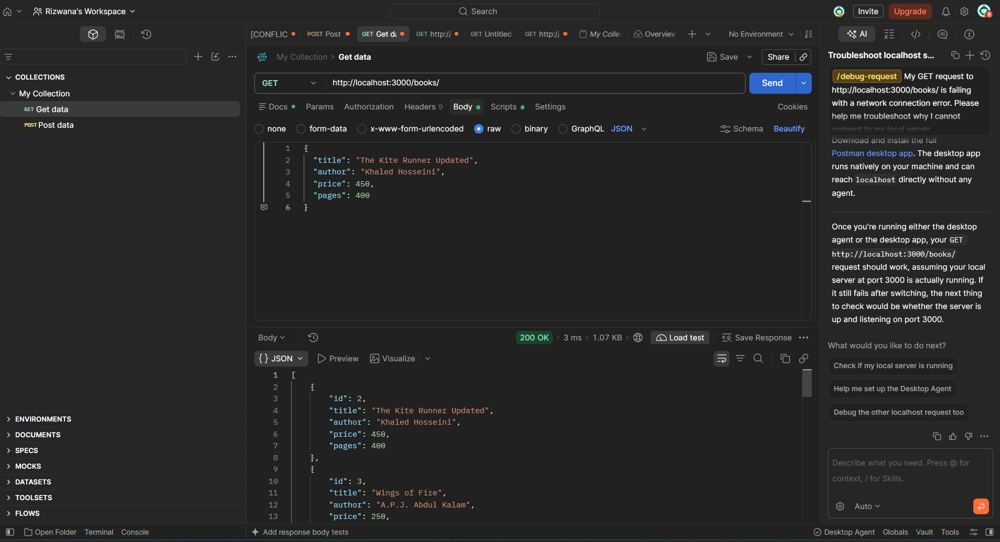

### 2. GET - Book by ID
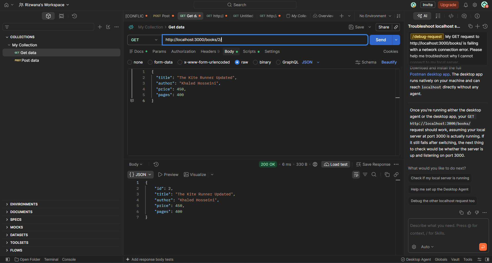

### 3. POST - Add a Book
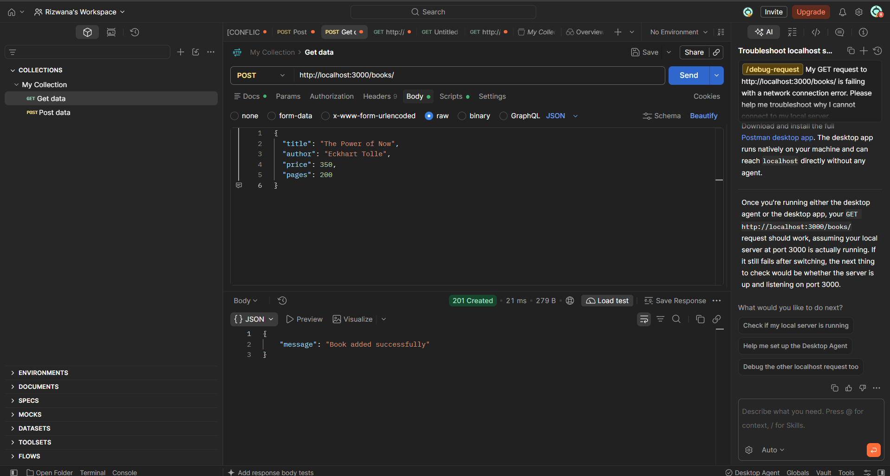

### 4. PUT - Update a Book
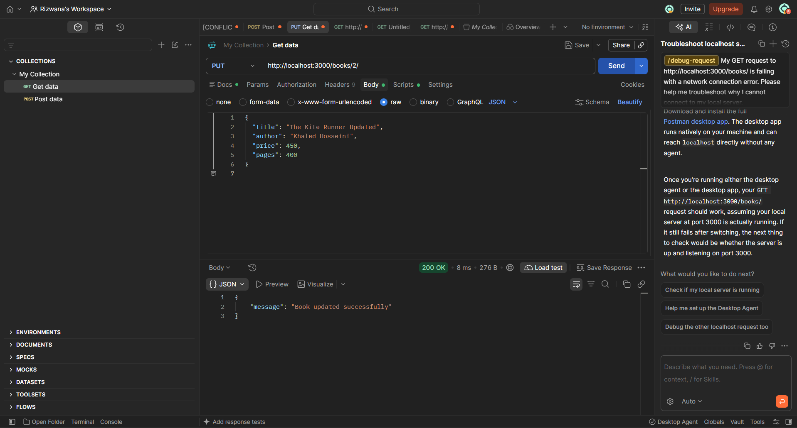

### 5. DELETE - Delete a Book
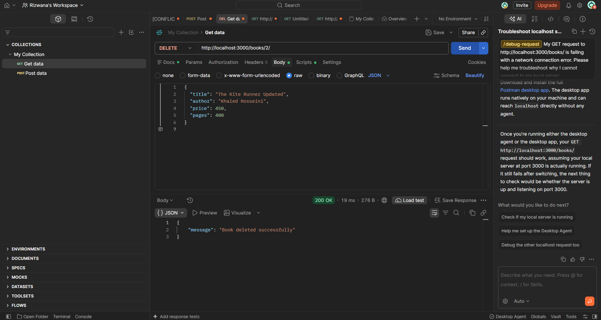

### 6. GET - Search Books
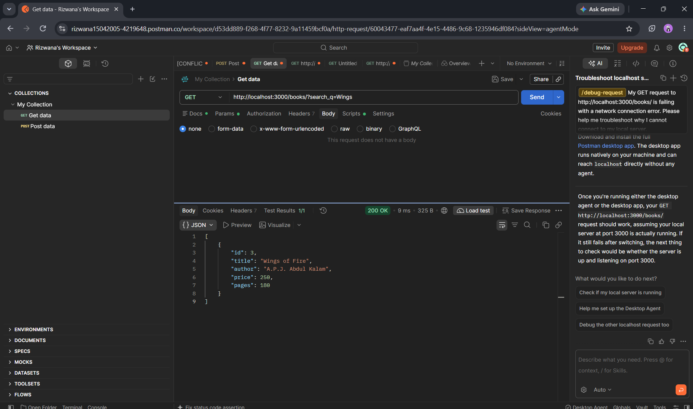

### 7. GET - Sort Books
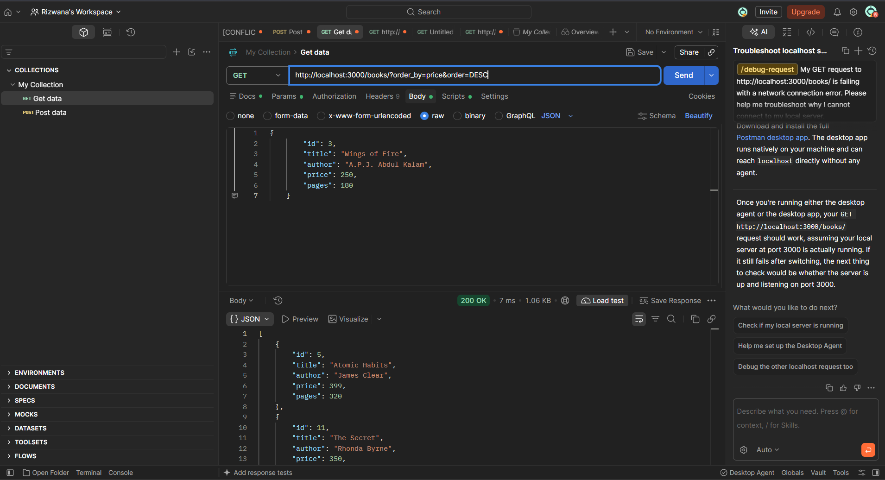

### 8. GET - Limit Books

### 9. GET - Offset Books
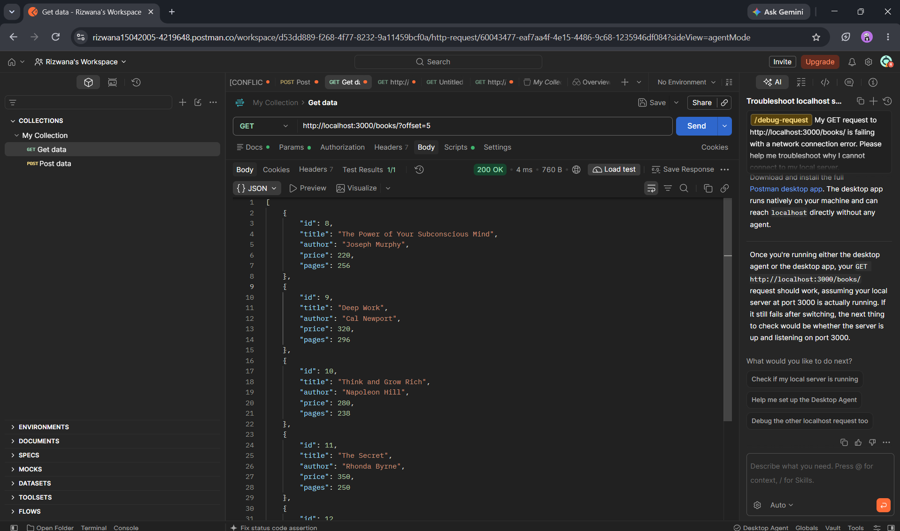

### 10. GET - Price Filter
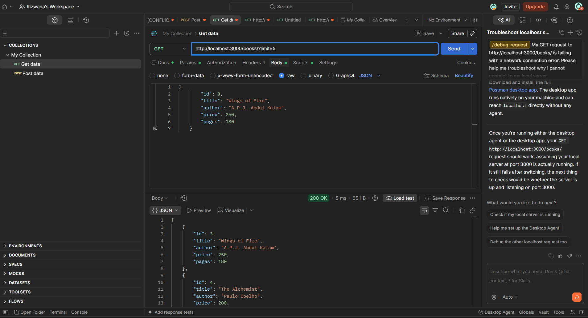

### 11. POST - Validation
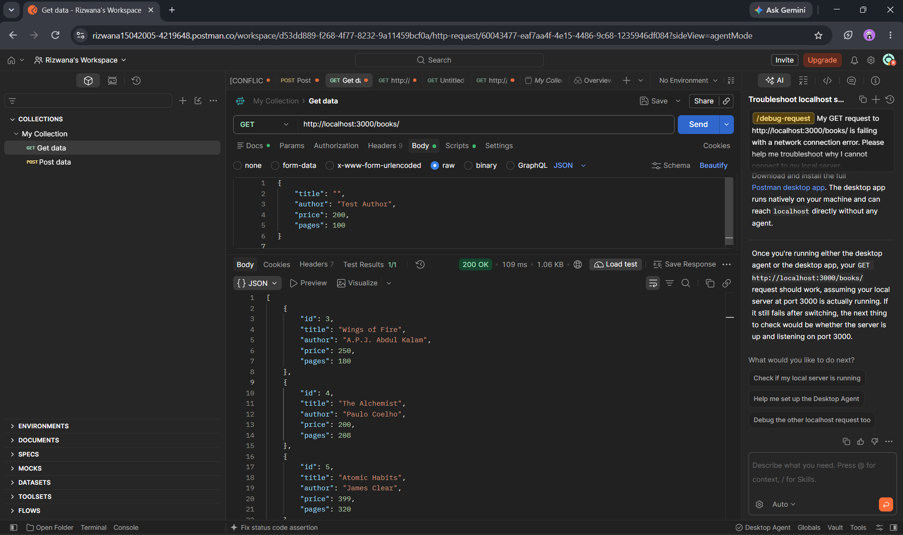

### 12. GET - Book Not Found
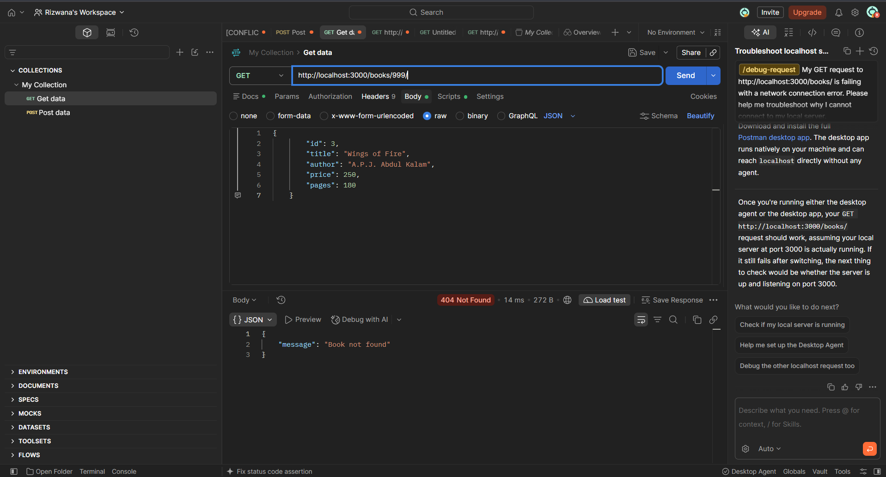

## Problems Faced and Solutions

- Faced database connection issues and resolved them.
- Learned how to send JSON data through Postman.
- Tested API operations and fixed errors.

